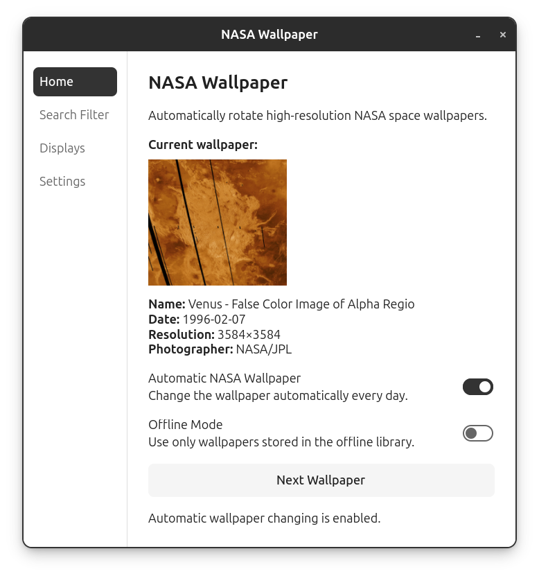

# NASA Wallpaper Releases

Official release downloads for **NASA Wallpaper**.

NASA Wallpaper is a desktop application that automatically finds and applies high-resolution space imagery from NASA's Image and Video Library as your wallpaper.

## Preview



## Features

- **Automatic daily wallpaper rotation**  
  Automatically changes your wallpaper once per day using NASA imagery that matches your selected filters. On Linux, this is handled through a user-level systemd timer.

- **Manual "Next Wallpaper" function**  
  Change to the next valid NASA wallpaper at any time without waiting for the automatic daily rotation.

- **NASA image filtering by subject**  
  Choose which types of space imagery should be included in the wallpaper pool, including nebulae, galaxies, planets, moons, and auroras.

- **Minimum photo year filtering**  
  Set the oldest year you want to allow when searching NASA's image library. This lets you focus on newer imagery or include older archival material.

- **Multiple image quality modes**  
  Choose how strict the application should be when accepting images. Higher-quality modes require larger images that better match modern desktop resolutions, while more permissive modes allow a broader range of NASA imagery.

- **Multi-monitor wallpaper handling**  
  Detects connected displays and creates a single wallpaper canvas that matches the complete desktop layout across multiple monitors.

- **Per-monitor display modes**  
  Each connected monitor can independently use either a fill-style crop or the image's original size and aspect ratio.

- **Offline wallpaper library creation support**  
  Pre-download wallpapers that match your current filters so NASA Wallpaper can continue rotating wallpapers without contacting NASA each time.

- **Local wallpaper history and maintenance tools**  
  Keeps track of previously used wallpapers to reduce repetition and includes tools for clearing wallpaper history and removing downloaded images.

- **Network retry protection**  
  If NASA cannot be reached because the computer has just resumed from sleep or the network/DNS connection is temporarily unavailable, NASA Wallpaper automatically retries after:
  - 1 minute
  - 5 minutes
  - 30 minutes
  - 1 hour

  If all retries fail, the current wallpaper is left unchanged rather than crashing the wallpaper service.

- **Application logging**  
  Final network failures are recorded in:

  `~/.local/state/nasa-wallpaper/nasa-wallpaper.log`

## Current Release

### Version 1.0.1

Version 1.0.1 is a maintenance release focused on network reliability.

Changes include:

- Automatic retry handling for temporary NASA/network failures
- Improved behavior after waking from sleep
- Clean handling of DNS and internet outages
- Application logging for failed network retry sequences
- Extended systemd service timeout to support the full retry schedule

### Linux

Debian/Ubuntu package:

`nasa-wallpaper_1.0.1_all.deb`

## Installation

Download the latest `.deb` from the GitHub Releases page and install it with:

```bash
sudo apt install ./nasa-wallpaper_1.0.1_all.deb
```

After installation, **NASA Wallpaper** will appear in your application menu.

Existing users can install the package the same way to upgrade from an earlier version.

## Automatic Wallpaper Rotation

NASA Wallpaper installs a user-level systemd timer that can automatically change the wallpaper every day.

The automatic service uses the same filters, image-quality settings, offline-mode settings, and display configuration selected in the application.

## Supported Platforms

Current release:

- Debian / Ubuntu based Linux distributions
